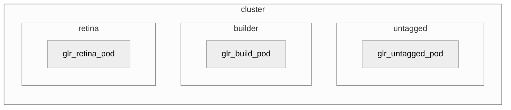
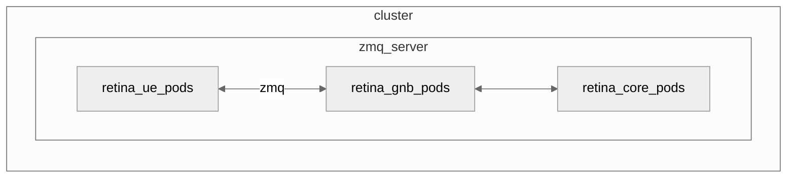
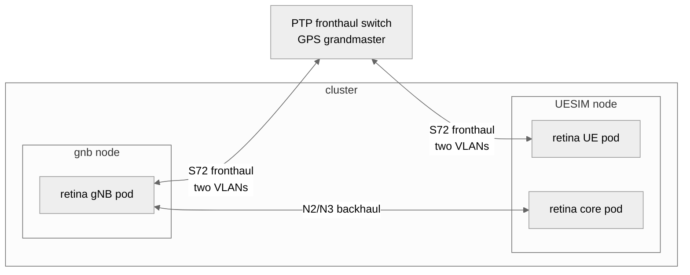
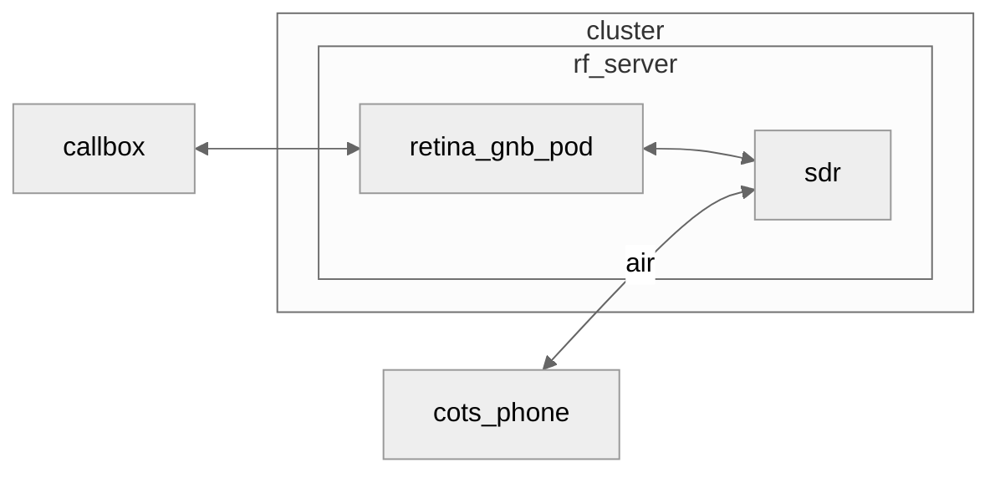

# IaC Full Example

This folder contains a full example of a cluster defined in IaC. It covers the following testbeds:

## Gitlab runners

- 1 PC/VM for building OCUDU
- 1 PC/VM for untagged jobs
- 1 PC/VM for running Retina Tests

## ZMQ Testbed

- 1 Server to run one or multiple ZMQ tests

## s72 Testbed

An S72 testbed runs the OCUDU split 7.2 gNB against an Amarisoft UE Simulator (UESIM). In the standard deployment, both machines are Kubernetes nodes: Retina schedules the gNB on the gNB node and the UE simulator and core on the UESIM node. The S72 fronthaul is a dedicated Layer-2 network; N2/N3 traffic uses the normal backhaul network.

For the full host, network, timing and Retina setup, see the [S72 testbed guide](testbeds/s72.md).

## RF Testbed

- 1 Server to run OCUDU, with a SDR
- 1 COTS Phone
- 1 Core (outside of the cluster)
